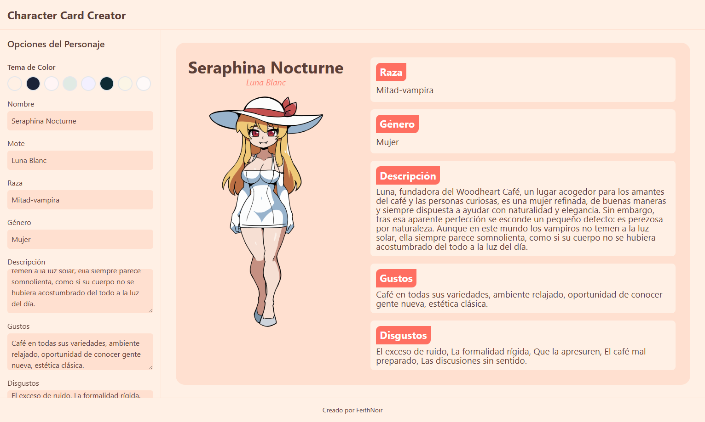

# 🎴 Character Card Creator  

✨ A simple, elegant, and fun web application to **create, customize, and download** character cards for your **original characters (OCs)**, **RPGs**, or any creative project.  

---

## 📖 Description  

This project is a lightweight **vanilla JavaScript** tool that lets you generate **visually appealing character cards**.  

With it you can:  
📝 Fill in details like name, race, gender, description, likes, and dislikes.  
🖼️ Upload a custom image.  
🎨 Choose from multiple **color themes**.  
💾 Save your progress locally in the browser.  
📥 Download the final card as a **PNG image** ready to share.  

---

## 🚀 Features  

- 🧾 **Character details:** Name, nickname, race, gender, description, likes, and dislikes.  
- 🖼️ **Image upload:** Add your own art or references.  
- 🎨 **Color themes:** Instantly switch between pre-designed styles.  
- 👀 **Live preview:** Watch your card update in real time.  
- 💾 **Save in browser:** Persist character data with `localStorage`.  
- 📥 **Download as PNG:** Export high-quality images using `html2canvas`.  
- 📱 **Responsive design:** Works smoothly on mobile, tablet, and desktop.  

---

## 🌱 Future Plans  

Planned improvements and upcoming features:  

- ⚡ **Migration to a modern framework:** Move to **Angular** for scalability and maintainability.  
- 🎨 **More customization:** Additional fields, custom layouts, and font options.  
- 📂 **Data management:** Better ways to save, load, and organize multiple profiles.  

---

## 👤 Author  

Created with 💖 by **Feith Noir**.  

🔗 **GitHub:** [FeithNoir](https://github.com/FeithNoir)  

---

## 📜 License  

This project is licensed under the **MIT License**. See the [LICENSE](LICENSE) file for details.  

---
